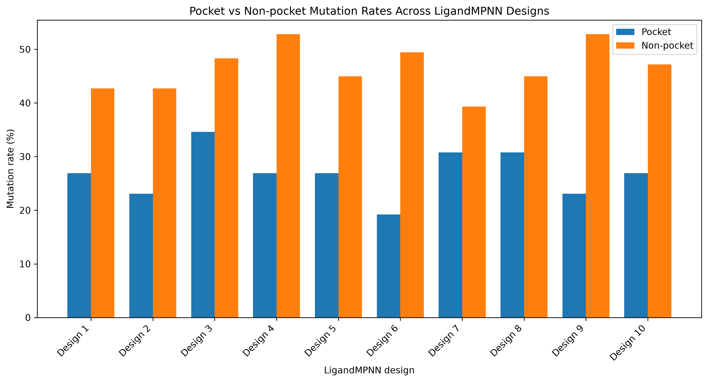
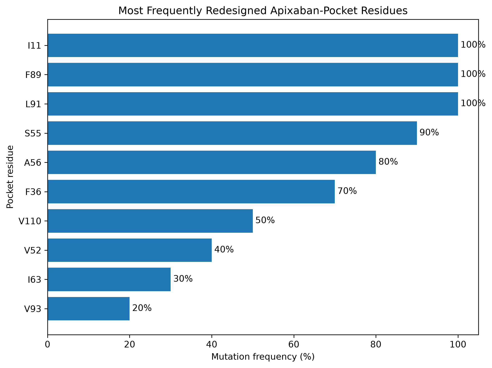

# LigandMPNN Analysis of an Apixaban-Binding Protein

## Overview

This project explores how **LigandMPNN** redesigns protein sequences in the presence of a bound small-molecule ligand.

After reproducing a basic LigandMPNN workflow using a tutorial structure, I selected the experimentally determined apixaban-binding protein **8VEZ (apx1049)** as the final analysis target.

The main goal was to examine whether residues close to the bound ligand show different redesign patterns from residues located outside the ligand-binding pocket.

---

## Research Question

**How do mutation patterns differ between apixaban-contacting pocket residues and non-pocket residues when 8VEZ is redesigned using LigandMPNN?**

A secondary question was:

**Do frequently redesigned pocket positions preserve similar physicochemical properties even when their amino-acid identities change?**

---

## Target Structure

- **PDB:** 8VEZ
- **Protein:** apx1049
- **Ligand:** Apixaban
- **Ligand identifier:** GG2
- **Protein chain:** A

The ligand-binding pocket was operationally defined as residues containing at least one protein atom within **5 Å of any apixaban atom**.

This is a geometry-based definition and does not necessarily mean that every identified residue directly contributes to binding affinity.

---

## Project Workflow

```text
LigandMPNN tutorial reproduction
        ↓
PDB / FASTA parsing practice
        ↓
Target selection: 8VEZ
        ↓
Identify apixaban-proximal residues
        ↓
Define a 5 Å ligand-binding pocket
        ↓
Generate 10 LigandMPNN sequence designs
        ↓
Compare native and designed sequences
        ↓
Calculate residue-level mutation frequencies
        ↓
Compare pocket vs non-pocket mutation rates
        ↓
Identify frequently redesigned pocket residues
        ↓
Analyze amino-acid substitution patterns
```

---

## LigandMPNN Design Settings

- **Model:** LigandMPNN
- **Temperature:** 0.1
- **Random seed:** 111
- **Ligand atomic context:** enabled
- **Ligand score cutoff:** 5.0 Å
- **Batch size:** 1
- **Number of batches:** 10
- **Generated designs:** 10

All designs were generated using the same experimental 8VEZ backbone.

---

# Results

## 1. Pocket residues were more conserved than non-pocket residues

Across the 10 LigandMPNN designs:

- **Mean pocket mutation rate: 26.92%**
- **Mean non-pocket mutation rate: 46.52%**

Pocket residues showed a **19.60 percentage-point lower mutation rate** than non-pocket residues.

The same overall pattern was observed across all 10 generated designs.



**Figure 1.** Pocket and non-pocket mutation rates across 10 LigandMPNN designs. Pocket residues were defined using a 5 Å ligand-distance cutoff.

These results show that ligand-proximal residues were relatively more conserved than residues outside the pocket under the tested LigandMPNN design conditions.

---

## 2. Pocket conservation was not uniform across residues

Although the pocket was more conserved overall, several individual ligand-proximal positions were frequently redesigned.

The most frequently mutated pocket residues were:

| Residue | Minimum distance to apixaban | Mutation frequency |
|---|---:|---:|
| I11 | 3.72 Å | 100% |
| F89 | 3.57 Å | 100% |
| L91 | 3.52 Å | 100% |
| S55 | 4.73 Å | 90% |
| A56 | 4.01 Å | 80% |
| F36 | 4.52 Å | 70% |
| V110 | 3.63 Å | 50% |
| V52 | 4.21 Å | 40% |
| I63 | 3.95 Å | 30% |
| V93 | 3.94 Å | 20% |



**Figure 2.** Pocket residues ranked according to the fraction of designs in which their amino-acid identity differed from the native 8VEZ sequence.

This indicates that the binding pocket is not uniformly constrained. Some ligand-proximal positions remained highly redesignable despite the lower overall pocket mutation rate.

---

## 3. Sequence variability and physicochemical variability were not always equivalent

The five most frequently redesigned pocket residues showed different substitution patterns.

| Residue | Mutation frequency | Designed residues | Interpretation |
|---|---:|---|---|
| **I11** | 100% | V ×10 | Hydrophobic character strongly conserved |
| **F89** | 100% | T ×5, K ×4, E ×1 | Large change from aromatic/hydrophobic to polar or charged residues |
| **L91** | 100% | T ×9, R ×1 | Hydrophobic residue predominantly replaced by a polar residue |
| **S55** | 90% | A ×9, S ×1 | Reduced polarity and side-chain size |
| **A56** | 80% | M ×8, A ×2 | Hydrophobic character retained with increased side-chain size |

### I11

I11 was redesigned to valine in all 10 designs.

Isoleucine and valine are both branched hydrophobic amino acids, meaning that amino-acid identity changed while the overall hydrophobic character remained strongly conserved.

### F89

F89 was mutated in every design, primarily to threonine or lysine.

Unlike the native aromatic and hydrophobic phenylalanine, the redesigned residues were mainly polar or charged, indicating a substantial change in local side-chain chemistry.

### L91

L91 was replaced by threonine in 9 of 10 designs and by arginine in one design.

This represents a strong shift from a hydrophobic residue toward predominantly polar chemistry.

### S55

S55 was changed to alanine in 9 of 10 designs.

This substitution removes the serine hydroxyl group and reduces side-chain polarity.

### A56

A56 was replaced by methionine in 8 of 10 designs.

Both residues are hydrophobic, but methionine has a substantially larger side chain, suggesting preservation of hydrophobic character with altered packing volume.

---

# Interpretation

The main finding of this analysis is that **sequence conservation depends strongly on local structural context**.

Residues close to apixaban were globally more conserved than non-pocket residues. However, residue-level analysis revealed substantial heterogeneity within the binding pocket.

Some positions, such as I11, F89, and L91, were redesigned in every generated sequence.

Importantly, high mutation frequency did not necessarily imply loss of chemical similarity.

For example:

```text
I11 → V
```

occurred in all 10 designs, but both residues are hydrophobic and structurally similar.

In contrast:

```text
F89 → T / K / E
L91 → T / R
```

represent much larger changes in polarity, charge, and side-chain chemistry.

Therefore, this analysis highlights an important distinction between:

- **sequence conservation**
- **physicochemical conservation**

when interpreting protein-design outputs.

---

# Limitations

This project is an exploratory computational study and has several limitations.

1. Only one protein–ligand system was analyzed.
2. Only 10 LigandMPNN designs were generated.
3. Pocket residues were defined using a simple 5 Å geometric cutoff.
4. Mutation frequency does not directly indicate energetic favorability.
5. LigandMPNN confidence scores do not represent experimental binding affinity.
6. No molecular dynamics or explicit energetic calculations were performed.
7. No experimental protein-expression, stability, or binding measurements were performed.
8. Designs were evaluated relative to a fixed experimental backbone.

Therefore, the results should be interpreted as **sequence-design patterns predicted by LigandMPNN**, rather than evidence that any generated sequence has improved apixaban binding.

---

# Future Work

Possible extensions of this project include:

- generating a larger number of LigandMPNN designs
- testing multiple sampling temperatures
- comparing LigandMPNN with ProteinMPNN without ligand context
- quantitatively classifying amino-acid property changes
- examining selected substitutions in 3D structural context
- evaluating designed sequences using structure prediction
- performing energetic or stability calculations
- experimentally testing selected designs for expression, stability, and ligand binding

---

# Repository Structure

```text
protein-design/
│
├── data/
│   ├── raw/
│   └── target/
│
├── docs/
│   ├── sequence_comparison.md
│   ├── multiple_design.md
│   ├── pocket_mutations.md
│   ├── mutation_visualization.md
│   ├── ligandmpnn_day3.md
│   └── project_question.md
│
├── figures/
│   ├── paired_mutation_rates.png
│   ├── residue_mutation_frequency.png
│   ├── pocket_vs_nonpocket_mutation_rates.png
│   └── top_pocket_residue_mutation_frequency.png
│
├── notebooks/
│
├── results/
│   ├── 8VEZ_pocket_residues.csv
│   ├── mutations.csv
│   ├── design_summary.csv
│   ├── pocket_mutation_summary.csv
│   ├── ranked_pocket_residues.csv
│   ├── residue_mutation_frequency.csv
│   └── top5_pocket_substitutions.csv
│
├── scripts/
│   ├── analyze_pocket_mutations.py
│   ├── analyze_top_pocket_substitutions.py
│   ├── compare_sequences.py
│   ├── find_ligand_neighbors.py
│   ├── find_zn_neighbors.py
│   ├── inspect_pdb.py
│   ├── plot_mutation_frequency.py
│   ├── plot_pocket_vs_nonpocket.py
│   ├── plot_top_pocket_residues.py
│   ├── read_fasta.py
│   └── summarize_designs.py
│
├── .gitignore
└── README.md
```

---

# What I Practiced

This project was also used to build foundational computational protein-design skills.

### Computational

- Linux / WSL command-line workflows
- Conda environment management
- Python scripting
- file and path handling
- FASTA parsing
- PDB parsing
- CSV-based data processing
- pandas
- matplotlib
- Git / GitHub version control

### Structural Biology

- PDB ATOM and HETATM records
- protein chains and residue numbering
- ligand identification
- Cartesian coordinates
- protein–ligand distance calculations
- distance-based pocket definition

### Protein Design

- LigandMPNN sequence generation
- native vs designed sequence comparison
- mutation frequency analysis
- ligand-contact vs non-contact residue comparison
- amino-acid physicochemical interpretation
- distinction between computational confidence and experimental validation

---

# Key Takeaway

LigandMPNN generated multiple alternative sequences for the same apixaban-binding protein backbone while showing substantially greater sequence conservation near the bound ligand.

The mean mutation rate was:

```text
Pocket:      26.92%
Non-pocket:  46.52%
```

However, pocket conservation was highly position-dependent.

Several ligand-proximal residues were redesigned in nearly every generated sequence, and some substitutions preserved physicochemical properties even when amino-acid identity changed.

Together, these results suggest that **ligand-proximal sequence constraints are heterogeneous and that sequence identity alone does not fully describe the chemical constraints learned by a protein-design model.**