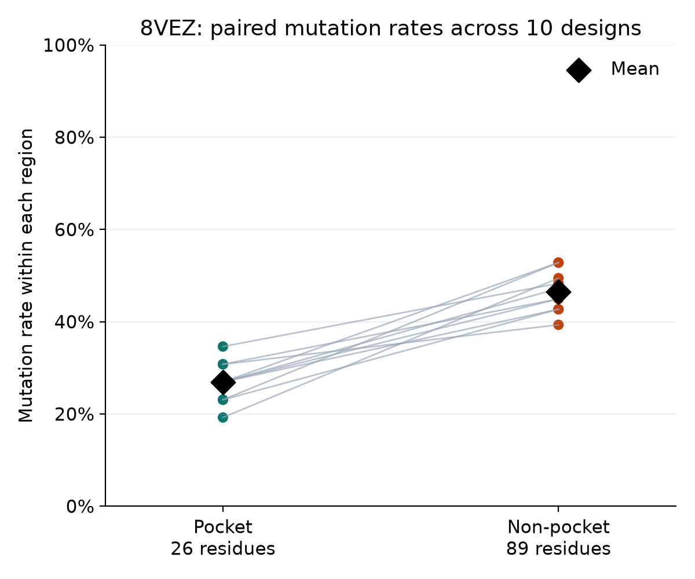
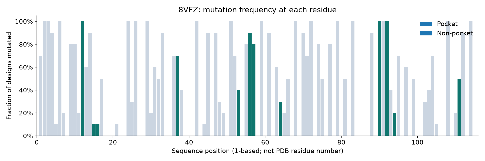

# Mutation pattern visualization

## Main result

Across these ten designs, the mean pocket mutation rate was
26.92%, compared with 46.52% outside the pocket.

The pocket mutation rate was lower in 10/10 designs.

The mean paired difference was
-19.59 percentage points.

## Paired comparison

Each line connects the pocket and non-pocket mutation rates
for the same LigandMPNN design.

Black diamonds indicate the mean values.

## Residue-level patterns

The x-axis uses FASTA sequence positions rather than PDB residue numbers.

Pocket residues conserved in every design: 14/26.

## Five highest-frequency pocket residues

All pocket residues ranked by mutation frequency are saved in:

results/ranked_pocket_residues.csv

Ties are ordered by sequence position.

| PDB residue | Sequence position | Mutated designs | Frequency |
|---|---:|---:|---:|
| A:I11 | 12 | 10/10 | 100% |
| A:F89 | 90 | 10/10 | 100% |
| A:L91 | 92 | 10/10 | 100% |
| A:S55 | 56 | 9/10 | 90% |
| A:A56 | 57 | 8/10 | 80% |

## Interpretation and limitations

Pocket residues were more conserved than non-pocket residues
across this set of generated sequences.

However, individual pocket positions showed substantially different
mutation frequencies.

A frequently mutated residue should be interpreted as a candidate
for further structural inspection rather than evidence of improved
binding or an experimentally validated binding hotspot.

All designs were generated from a single protein backbone using
one sampling configuration.

No statistical significance, experimental binding affinity,
protein stability, or causal effect of ligand context is claimed.

The ligand-binding pocket was defined using a 5 Å heavy-atom
distance cutoff calculated directly from the 8VEZ structure.
